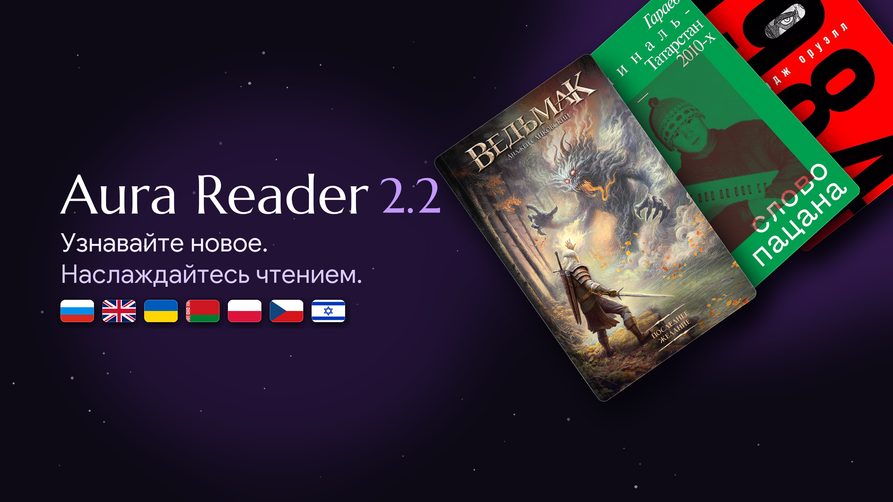

  
    

  
  
  
  

---

<h2> English</h2>

**Aura Reader** is a fast, lightweight, and modern e-book reader for Android. Created for comfortable daily reading without ads, bloatware, or intrusive tracking.

### Features

- **Lightweight & Fast**: Compact build weighing around **5 MB** with instant startup and smooth animations.
- **Broad Format Support**: Opens **EPUB**, **FB2**, **FB2.ZIP**, **TXT**, **MOBI**, **AZW3**, **PDF**, and **CBZ** comic archives. You can also browse and download books directly from online **OPDS** catalogs.
- **Two Interface Styles**: Switch between **Material 3** with Material You dynamic colors and **Liquid Glass** featuring translucent blur panels, light reflections, and fluid physics.
- **Flexible Reading Modes**: Choose between realistic 3D page flip, page curl, horizontal slide, or continuous vertical scroll.
- **Typography & Themes**: Includes Light, Dark, Sepia, and pure black AMOLED themes. Fine-tune font size, line spacing, and margins, or import any custom TTF/OTF font for the interface and reading view.
- **Interactive Library & Widget**: Features a "Now Reading" hero card with cover-matched glow, 3D parallax book covers that react to device tilt and touch, and a home screen widget showing your current book and progress.
- **Background Text-to-Speech**: Listen to books in the background with real-time word highlighting, auto-scrolling, tap-to-start from any word, voice selection, and lock screen media controls.
- **Dictionary, Translator & Footnotes**: Read footnotes in instant popups without losing your place, look up word forms in the offline dictionary, or translate foreign text right inside the reader.
- **Search & Highlights**: Full-text search across a book or your entire library, plus multi-paragraph text selection for saving quotes and colored highlights.
- **Reading Stats & Milestones**: Track daily streaks, reading speed, total hours, and weekly activity charts, with celebratory animations when you finish a book.
- **Seasonal Atmosphere**: Optional holiday themes, palettes, and greetings for Halloween, New Year, Christmas, Valentine's Day, and Easter that can be toggled off anytime.
- **Backups, Updates & Privacy**: Export and restore your entire library and reading progress in one file, and install app updates directly from settings. Zero ads; optional anonymous usage telemetry via TelemetryDeck can be disabled in settings — see [PRIVACY.md](PRIVACY.md).
- **7 Languages**: Fully localized into English, Russian, Ukrainian, Belarusian, Polish, Czech, and Hebrew.

### Installation

Download the latest **`AuraReader.apk`** from the [Releases](https://github.com/Kouqqu/aura-reader/releases/latest) page and install it on your Android device. Subsequent updates can be downloaded and installed directly inside the app.

### License

This project is open-source and licensed under the [GNU General Public License v3.0](LICENSE).

---

<h2> Русский</h2>

**Aura Reader** — быстрая, лёгкая и современная читалка для Android. Создана для комфортного ежедневного чтения без рекламы, лишнего шума и назойливой слежки.

### Возможности

- **Лёгкость и скорость**: Компактное приложение весом около **5 МБ** с мгновенным запуском и плавными анимациями.
- **Поддержка популярных форматов**: Открывает **EPUB**, **FB2**, **FB2.ZIP**, **TXT**, **MOBI**, **AZW3**, **PDF** и комиксы **CBZ**, а также позволяет искать и скачивать книги напрямую из сетевых **OPDS-каталогов**.
- **Два стиля оформления**: Переключайтесь между классическим **Material 3** с динамическими цветами системы и **Liquid Glass** со стеклянным размытием, световыми бликами и плавной физикой панелей.
- **Режимы чтения**: Реалистичный 3D-разворот страниц, перелистывание с загибом уголка, постраничный сдвиг или непрерывная вертикальная лента.
- **Типографика и темы**: Светлая, Тёмная, Сепия и чисто чёрная AMOLED-тема. Гибкая настройка размера шрифта, межстрочного интервала и отступов, а также импорт любых своих TTF/OTF-шрифтов.
- **Живая библиотека и виджет**: Карточка «Сейчас читаю» со свечением в тон обложки, интерактивные 3D-обложки с параллакс-эффектом от наклона телефона и виджет для рабочего стола с прогрессом чтения.
- **Фоновая озвучка текста**: Прослушивание книг в фоне с подсветкой читаемого слова в реальном времени, автопрокруткой, запуском с любого выбранного слова, выбором голоса и управлением с экрана блокировки.
- **Словарь, переводчик и сноски**: Всплывающие сноски без потери места в тексте, умный поиск начальных форм слов в офлайн-словаре и встроенный переводчик прямо в окне чтения.
- **Поиск и цитаты**: Полнотекстовый поиск по книге и всей библиотеке, а также удобное выделение фрагментов для сохранения цитат и цветных заметок.
- **Статистика чтения**: Подсчёт ежедневных стриков, скорости чтения, общего времени и наглядные графики активности за неделю, плюс небольшое поздравление при завершении книги.
- **Праздничная атмосфера**: Ненавязчивое сезонное оформление к Хэллоуину, Новому году, Рождеству, Дню святого Валентина и Пасхе, которое при желании легко отключается в настройках.
- **Бэкапы, обновления и приватность**: Резервное копирование всей библиотеки и прогресса в один файл и установка обновлений прямо внутри приложения. Никакой рекламы; опциональная анонимная аналитика через TelemetryDeck отключается одним переключателем в настройках — подробности в [PRIVACY.md](PRIVACY.md).
- **7 языков интерфейса**: Русский, английский, украинский, белорусский, польский, чешский и иврит.

### Установка

Скачайте свежий **`AuraReader.apk`** со страницы [Releases](https://github.com/Kouqqu/aura-reader/releases/latest) и установите на смартфон. Дальше приложение сможет проверять и устанавливать обновления самостоятельно.

### Лицензия

Проект распространяется под свободной лицензией [GNU General Public License v3.0](LICENSE).
